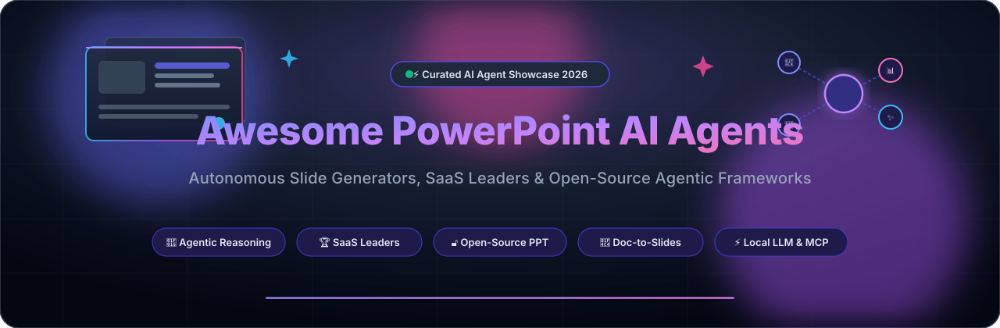
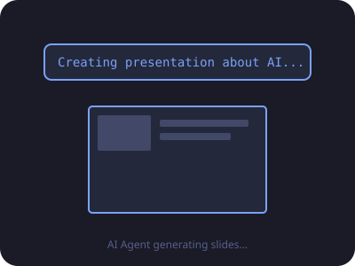

<!-- SEO Meta Tags -->
<!--
  Title: Awesome PowerPoint AI Agents - Curated List of AI Slide Generators & Autonomous PPT Tools
  Description: Discover the ultimate curated collection of AI agents for PowerPoint and slide creation. Explore SaaS platforms, open-source LLM agents, local MCP tools, and document-to-presentation workflows including Gamma, Tome, Presenton, and PPTAgent.
  Keywords: AI Presentation, PowerPoint AI, AI Slide Generator, Presentation Agent, Autonomous Slides, Open Source PPT AI, Gamma AI, Tome, Presenton, SlideDeck AI, Marp, Copilot PowerPoint, AI PPT Maker
-->

# 🚀 Awesome PowerPoint AI Agents 🪄

**A comprehensive, curated ecosystem of autonomous AI agents, commercial SaaS powerhouses, and open-source GitHub frameworks engineered to automate presentation design, narrative generation, and slide deck authoring with multi-step reasoning.**

[✨ Overview](#-overview) • [⚡ Key Capabilities](#-key-capabilities) • [🏗️ SaaS Products](#-saas-products) • [🔓 Open-Source](#-open-source-github-projects) • [🤝 Contributing](#-how-to-contribute) • [💖 Support](#-support) • [📈 Star History](#-star-history)

---

## 🌟 Overview

Welcome to the definitive index of **AI Slide & PowerPoint Agents** 🤖. While legacy slide tools merely convert bullet points to basic outlines, next-generation **AI presentation agents** harness autonomous multi-step reasoning, contextual document retrieval (RAG), dynamic aesthetic layout generation, and interactive voice narration to craft executive-ready pitch decks and slide presentations in seconds.

### ✨ Key Capabilities

- 🤖 **Agentic Multi-Step Reasoning**: Autonomous planning, outline drafting, layout critique, and iterative refinement.
- 📂 **Multimodal Document Intelligence**: Seamlessly converting PDFs, Word documents, research papers, and web URLs into coherent slide decks.
- 🎨 **Adaptive Smart Design**: Dynamic theme generation, brand-consistent palette matching, and auto-balancing typography.
- 🌍 **RAG-Style Grounding & Fact-Checking**: Integrating internal enterprise knowledge and real-time web retrieval for verified accuracy.
- 🔌 **Tool Use & MCP Integrations**: Model Context Protocol (MCP) servers and APIs connecting slide engines directly to IDEs and agent workforces.

---

## 🏗️ SaaS Products

### 📊 Sector Overview & Market Dynamics

The global presentation software and AI slide generation market is estimated at **$9.5B+ (projected to exceed $25B by 2030 at a ~17% CAGR)**, fueled by enterprise demand for generative workflow automation. The sector is currently **moderately fragmented**: while hyperscale incumbents like Microsoft (Copilot) and Canva command massive distribution moats, specialized breakout champions (such as Gamma and Beautiful.ai) capture substantial high-margin segments through superior narrative design, agile web-native formats, and autonomous agentic reasoning rather than a winner-take-all outcome.

> [!NOTE]
> All SaaS tools below are evaluated with transparent pricing, free tier / trial terms, and business scale metrics to help you select the ideal presentation solution.

### Core Platforms (Leaderboard) 🏆

| Product | Description | Pricing | Free Tier / Trial | Company Size (Valuation/Rev) |
| :--- | :--- | :--- | :--- | :--- |
| **[Gamma](https://gamma.app/)** ⚡ | **Industry Leader.** Prompt, document, or URL → complete decks with narrative flow. Features agentic storytelling and rich embeds. | Starts at ~$10/mo | 400 one-time credits (~10 decks); watermark included. | ~$2.1B Valuation / $100M+ ARR |
| **[Tome](https://tome.app/)** 📖 | **Sales & Narrative.** Turns ideas into story-driven decks with immersive visuals and web-like responsive layouts. | Starts at $16/mo | Limited monthly creates; includes "Made with Tome" watermark. | ~$1.3B Valuation |
| **[PopAi](https://popai.pro/)** 🚀 | **Rapid Growth.** Singapore-based productivity workspace; excellent for document-to-PPT conversion with AI outlining. | Starts at $10/mo | 1 AI presentation/week; 5 AI docs weekly. | ~1.5M+ Users / High-growth |
| **[Beautiful.ai](https://www.beautiful.ai/)** 🎨 | **Design-First.** Smart Slides that auto-adjust layouts with strict aesthetic guardrails for brand consistency. | Starts at $12/mo | 14-day free trial (CC required); no permanent free tier. | ~$13.5M+ ARR / $60M+ Funding |
| **[Plus AI](https://www.plus.ai/)** 🔌 | **Native Integration.** AI agent add-in for Google Slides & PowerPoint. Ideal for native enterprise workflows. | Starts at $10/mo | 7-day free trial (CC required); no permanent free tier. | ~$20M - $50M Valuation (Est.) |
| **[SlidesAI.io](https://www.slidesai.io/)** 🧩 | **Utility Choice.** Deep Google Slides integration with over 15M installs. Supports topic-to-presentation generation. | Starts at $10/mo | 3 presentations/month; 2,500 character limit. | ~$2.6M Valuation / $1.2M+ ARR |
| **[SlideSpeak](https://slidespeak.co/)** 📄 | **Document-to-PPT.** High-speed conversion from PDF/Word to editable PPTX with AI-powered redesigns. | Starts at ~$24/mo | 3 one-time credits; 50MB upload limit. | ~$2.5M Valuation (Est.) |

### Advanced & Specialized Agents 🛠️

| Product | Description | Pricing | Free Tier / Trial | Company Size (Valuation/Rev) |
| :--- | :--- | :--- | :--- | :--- |
| **[Microsoft Copilot](https://www.microsoft.com/en-us/microsoft-365/copilot)** 🏢 | **Enterprise Standard.** Deep Office 365 integration with OpenAI Sora 2 support, PPT templates, and voice prompting. | ~$20 - $30/mo | Free basic version; Copilot Pro for AI features. | Trillion-Dollar Company |
| **[Canva Magic Studio](https://www.canva.com/magic-studio/)** 🖌️ | **Design Ecosystem.** Integrated Magic Design for prompt-to-deck within the expansive Canva creative suite. | Starts at ~$12.99/mo | Limited shared pool (up to 200 standard/20 premium AI uses). | ~$40B+ Valuation / $3.5B+ Rev |
| **[Jotform Agents](https://www.jotform.com/ai-presentation-generator/)** 🎙️ | **Maker + Presenter.** Generates slides and delivers them with AI voice and real-time interactive Q&A. | Bundle with Jotform | Free trial available. | Billion-Dollar Private Company |
| **[Kroma.ai](https://kroma.ai/)** 📊 | **Data-Heavy.** Enterprise-ready platform focusing on data visualization, pitch decks, and brand governance. | Starts at $49.99/mo | Freemium available. | ~$20M - $40M Valuation / $4.2M+ ARR |
| **[Decktopus](https://www.decktopus.com/)** 🎯 | **Business Utility.** Specialized in quick pitch decks, business proposals, and lead-capturing forms. | Starts at $14.99/mo | 3 presentations limit; watermark included. | ~$8.6M Valuation / $3M+ ARR |
| **[Presentations.AI](https://www.presentations.ai/)** 🏢 | **High Volume.** Enterprise-grade with brand-safe templates and high-volume automated slide generation. | Starts at $20/mo | 100 one-time credits (4-5 decks); no export in free tier. | ~$7.9M Valuation / $2.6M+ ARR |
| **[Pi (Presentation Intelligence)](https://pi.inc/)** 💡 | **AI-Native.** Breakout leader generating bespoke, template-free responsive designs in seconds. | Freemium | Free-forever plan with no watermarks. | Seed Stage / Emerging |
| **[SlideGMM](https://slidegmm.com/)** 💰 | **Budget Choice.** High-speed, affordable generator that exports fully editable .pptx vector graphics. | Starts at $4.99/mo | Free prompt-based generation / PDF export. | Seed Stage / Emerging |
| **[Prezo AI](https://prezo.ai/)** 🔄 | **Multi-Format.** Dynamic canvas that effortlessly transforms content between slide, document, and web formats. | Starts at ~$10/mo | Freemium available. | Seed Stage / Emerging |

---

## 🔓 Open-Source GitHub Projects

Sorted descending by GitHub stars ⭐.

### Dedicated AI Slide / PowerPoint Agents 📂

- 📝 **[Marp Ecosystem](https://github.com/marp-team/marp)**   
  The gold standard for "Slides-as-Code." Modern AI agent workflows often generate Marp Markdown to render deterministic, version-controlled slides.
- 🌟 **[Presenton](https://github.com/presenton/presenton)**   
  The leading open-source alternative. Full REST API, custom HTML/Tailwind templates, and local LLM support (Ollama/Docker). Features a dedicated **MCP server** for agentic tool calling.
- 🤖 **[Orkas PptMaker](https://github.com/Orkas-AI/Orkas)**   
  Turns a natural language brief into a reviewable slide plan and editable presentation inside an open-source, local-first desktop AI workforce coordinated by a Commander agent.
- 🔬 **[PPTAgent / DeepPresenter](https://github.com/icip-cas/PPTAgent)**   
  Agentic framework for reflective PowerPoint generation (EMNLP 2025). Focuses on **multi-step reasoning** and deep research with a tool-enabled execution sandbox.
- 💻 **[presentation-ai (ALLWEONE)](https://github.com/allweonedev/presentation-ai)**   
  Next.js-based generator with real-time preview and interactive editing. Excellent for self-hosting and developers wanting a frictionless modern UI.
- 🧠 **[SlideDeck AI](https://github.com/barun-saha/slide-deck-ai)**   
  Co-creation assistant using LLMs (supports offline Ollama) to generate native PPTX files via structured JSON schema representations.
- 📄 **[slideitin](https://github.com/martin226/slideitin)**   
  Document-to-slides agent powered by Google Gemini. Streamlined for rapid doc summaries into presentation decks.
- 🐍 **[Odin-Slides](https://github.com/leonid20000/odin-slides)**   
  Python-based agent specialized in converting long-form academic research papers and documents into structured PowerPoint presentations.
- ⚡ **[AI-Presentation-Generator](https://github.com/mshumer/ai-presentation-generator)**   
  A "Zero API Key" approach utilizing free-tier Hugging Face models. Highly accessible for students and hobbyists without paid LLM accounts.

### Community Favorites & Tools 🛠️

- 🤖 **[SlideAI](https://github.com/siddhesh-desai/SlideAI)**  — Automatic PPT creator powered by OpenAI and Bing search.
- 🌐 **[nooqta/ai-presentation](https://github.com/nooqta/ai-presentation)**  — Converts Markdown into Reveal.js interactive web presentations via AI.
- 🧞 **[SlidesGenie](https://github.com/raphaeltony/SlidesGenie)**  — Topic-to-Google Slides automation (ChatGPT + DALL-E integration).
- 🧱 **[slidemason](https://github.com/erickittelson/slidemason)**  — 100% local slide builder without external API keys.

---

## 🤝 How to Contribute

Contributions make the open-source and AI communities thrive! 🚀

1. 🍴 **Fork** the Repository.
2. 🌿 **Create** your Feature Branch (`git checkout -b feature/AmazingAgent`).
3. 💾 **Commit** your Changes (`git commit -m 'Add AmazingAgent to open-source tools'`).
4. 📤 **Push** to the Branch (`git push origin feature/AmazingAgent`).
5. 🔀 **Open** a Pull Request.

---

## 💖 Support

Thank you so much for exploring and supporting **Awesome PowerPoint AI Agents**! 🙌

If you find this repository helpful, please consider:
- ⭐ **Starring** the repository on GitHub to help others discover it.
- 🍴 **Forking** and contributing your favorite tools, agents, or frameworks.
- 📢 **Sharing** with your colleagues, developer communities, and friends on social media.
- ☕ **Buying a Coffee / Sponsoring** the maintainer via the [GitHub Sponsors Dashboard](https://github.com/sponsors/ishandutta2007).

---

##  Star History

---

## 📝 Disclaimer

- 📌 This repository is a community-curated list and not an endorsement of any listed tool or service.
- 🔒 Always verify enterprise data privacy policies and licensing before submitting proprietary or sensitive documents to third-party AI tools.
- ✍️ AI-generated content should always be reviewed for brand compliance, factual accuracy, and design integrity.

---

  <b>Made with ❤️ for creators, marketers, founders, and developers.</b> 
  <i>Empowering creators to make presentation generation 10x faster and fully agentic.</i>

<!-- SEO Discovery Tags -->
<!-- AI, PowerPoint, AI Agents, Slides, Gamma, Tome, Beautiful.ai, Open Source, LLM, Ollama, LangChain, Pitch Deck, Slide Maker, Slide Generator, GenAI, Presentation Agents -->
